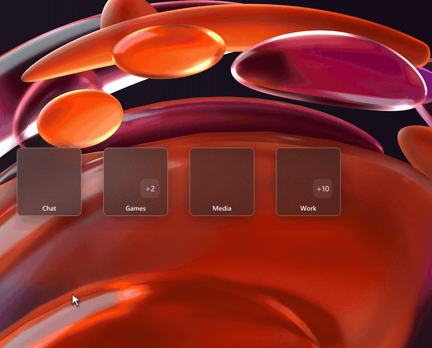
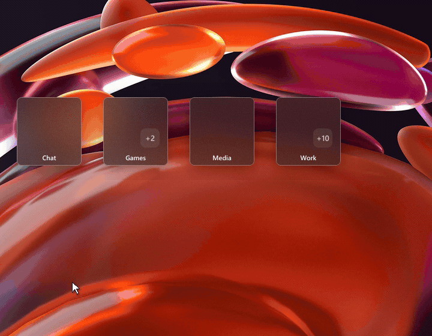
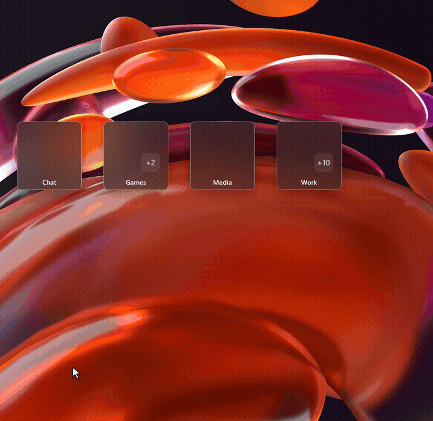
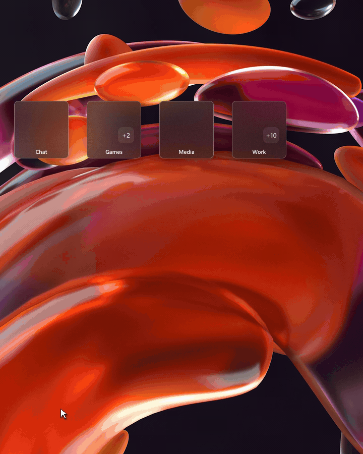
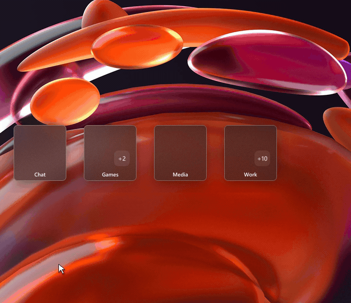

# Glass Folders

English · [Русский](README.ru.md)

Phone-style folders for the Windows desktop.
Every folder on your desktop becomes a glass tile with app icons. Click it, and a panel opens with your shortcuts sorted into groups.



## Why

A plain folder icon tells you nothing until you open it. On a phone, four small icons are enough to know what is inside. Glass Folders brings that to Windows.

## Features

**Tiles.** Each desktop folder becomes a tile that shows its most used apps. Resize it to see more icons, move it anywhere, snap it to a grid. Click an icon on the tile to launch the app right away.



**Groups.** Inside a folder, shortcuts live in groups. Drag a shortcut to an empty spot to make a new group, name it, give it a color. Move and resize groups, and the rest make room.



**Settings.** Hide names and labels for an icons-only look, pull groups to a corner, choose glass density and icon size.



**Pin.** Keep a folder open on the desktop as a widget.



**Right-click a shortcut** (in a folder or on a tile) to rename it, change its icon, delete it, or uninstall the whole app. Uninstall finds the app's own uninstaller and asks first.

**Drag shortcuts out.** Drop a shortcut on another folder's tile to move it there, or on the free desktop to put it back on the desktop.

**Smooth and fast.** Folders open instantly, even with hundreds of shortcuts. Animations follow your screen's refresh rate.

## Your files stay yours

There is no database. A tile is a real folder on your desktop, a group is a real subfolder inside it. Layout and colors are kept in a small hidden `.glassfolder.json` in each folder.
Close the app and you have the same plain folders as before. This holds even if the app crashes or is ended in Task Manager: a tiny helper process puts the folders back.

## Install

1. Download `glass-folders.zip` from [Releases](../../releases/latest) and unzip it.
2. Run `glass-folders.exe`.
3. To quit, open any folder, click the gear, then **Quit app**.

Requirements: Windows 11 with Transparency effects on (Settings → Personalization → Colors).
The interface is in English and Russian (picked from your Windows language; switch it in settings). The exe is not signed, so Windows SmartScreen may ask you to confirm the first launch.

## Light by design

Written in Rust with [Slint](https://slint.dev) and a small custom Win32 layer.
About 10 MB on disk, 20–30 MB of memory, no CPU use while idle.

## Build

```
cd app
cargo build --release
```

The exe appears in `app/target/release/`.

## License

[MIT](LICENSE)
