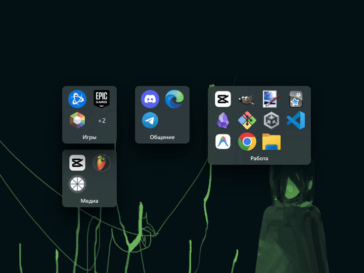
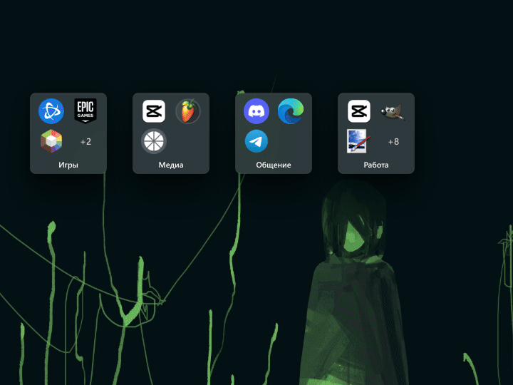
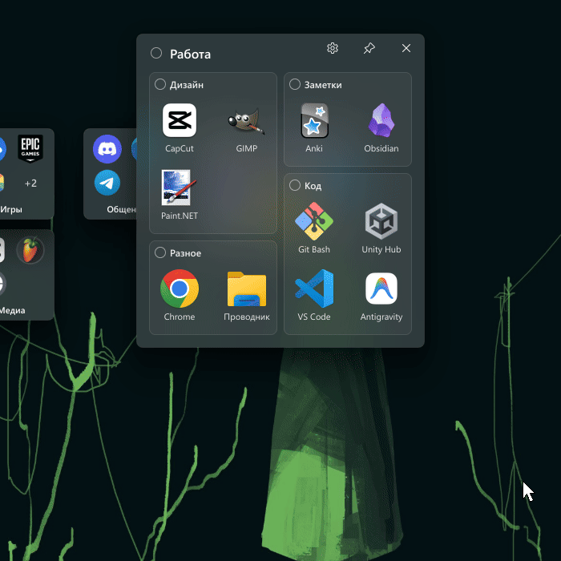
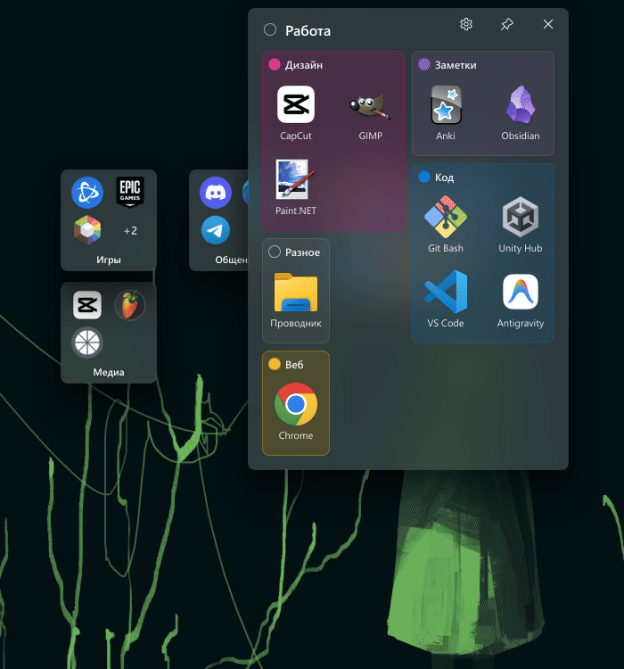
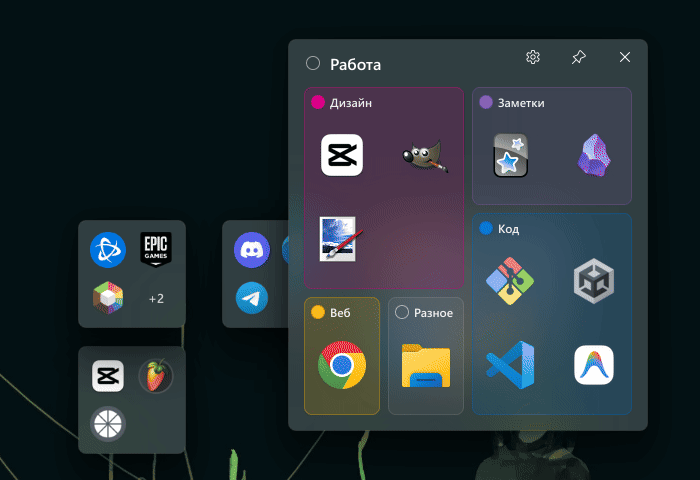

# Glass Folders

[English](README.md) · Русский

Папки как на телефоне, только для рабочего стола Windows.
Каждая папка на рабочем столе становится стеклянной плиткой с иконками приложений. Нажимаешь на неё, и открывается окно, где ярлыки разложены по группам.



## Зачем

По обычному значку папки не понять, что внутри, пока её не откроешь. На телефоне хватает четырёх маленьких иконок. Glass Folders делает так же на Windows.

## Возможности

**Плитки.** Каждая папка на рабочем столе становится плиткой с самыми используемыми приложениями. Плитку можно растянуть, чтобы видеть больше иконок, передвинуть куда угодно и выровнять по сетке. Приложение запускается кликом по иконке прямо на плитке.



**Группы.** Внутри папки ярлыки лежат в группах. Перетащи ярлык на пустое место, и появится новая группа: дай ей название и цвет. Группы можно двигать и растягивать, остальные сами подвинутся.



**Настройки.** Можно спрятать названия и подписи, чтобы остались только иконки, прижать группы к углу, выбрать плотность стекла и размер иконок.



**Закрепление.** Папку можно оставить открытой на рабочем столе, как виджет.



## Файлы остаются твоими

Никакой базы данных нет. Плитка — это настоящая папка на рабочем столе, группа — настоящая подпапка внутри неё. Расположение и цвета хранятся в маленьком скрытом файле `.glassfolder.json` в каждой папке.
Закрыл приложение — и у тебя те же обычные папки, что и раньше.

## Установка

1. Скачай `glass-folders.zip` из [Releases](../../releases/latest) и распакуй.
2. Запусти `glass-folders.exe`.
3. Чтобы выйти, открой любую папку, нажми на шестерёнку, затем **Закрыть программу**.

Нужна Windows 11 с включёнными эффектами прозрачности (Параметры → Персонализация → Цвета).
Exe не подписан, поэтому при первом запуске Windows SmartScreen может попросить подтверждение.

## Лёгкое

Написано на Rust со [Slint](https://slint.dev) и небольшим своим слоем для Win32.
Около 10 МБ на диске, 20–30 МБ памяти, в покое не нагружает процессор.

## Сборка

```
cd app
cargo build --release
```

Exe появится в `app/target/release/`.

## Лицензия

[MIT](LICENSE)
