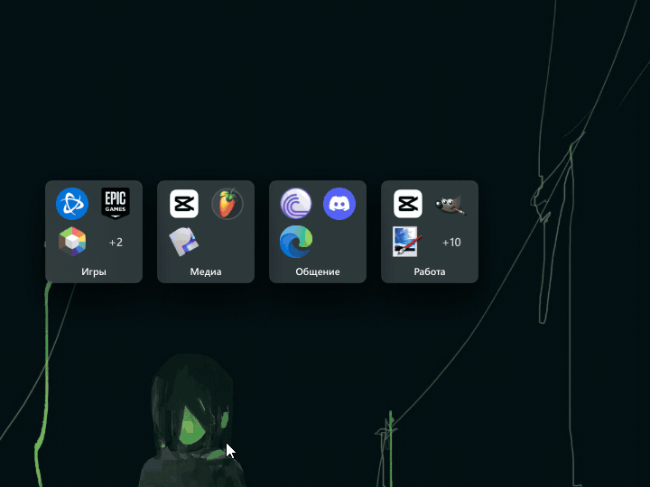
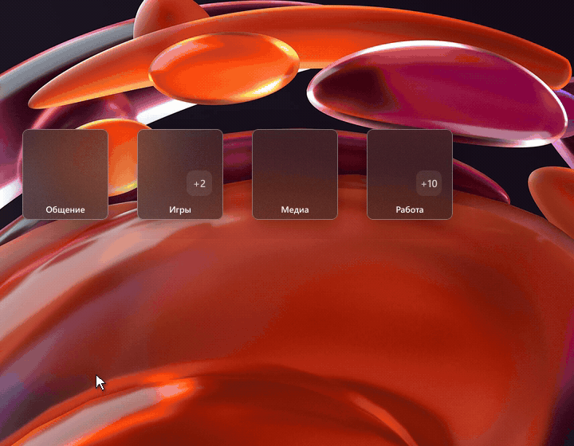
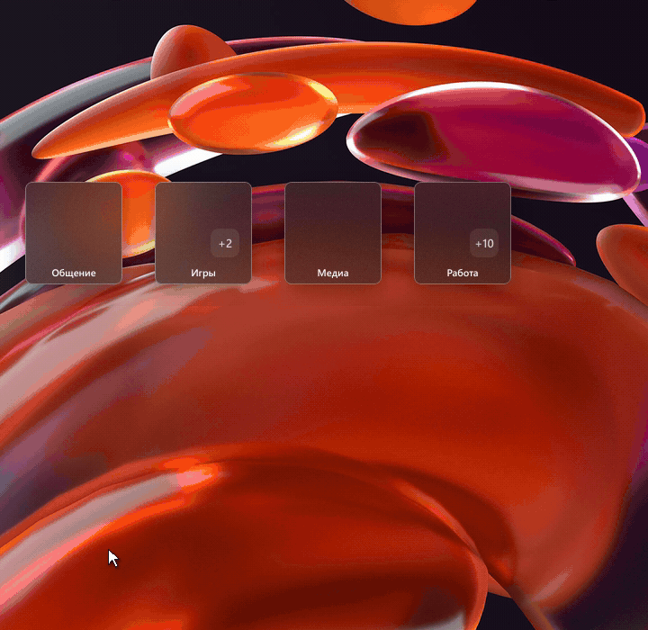
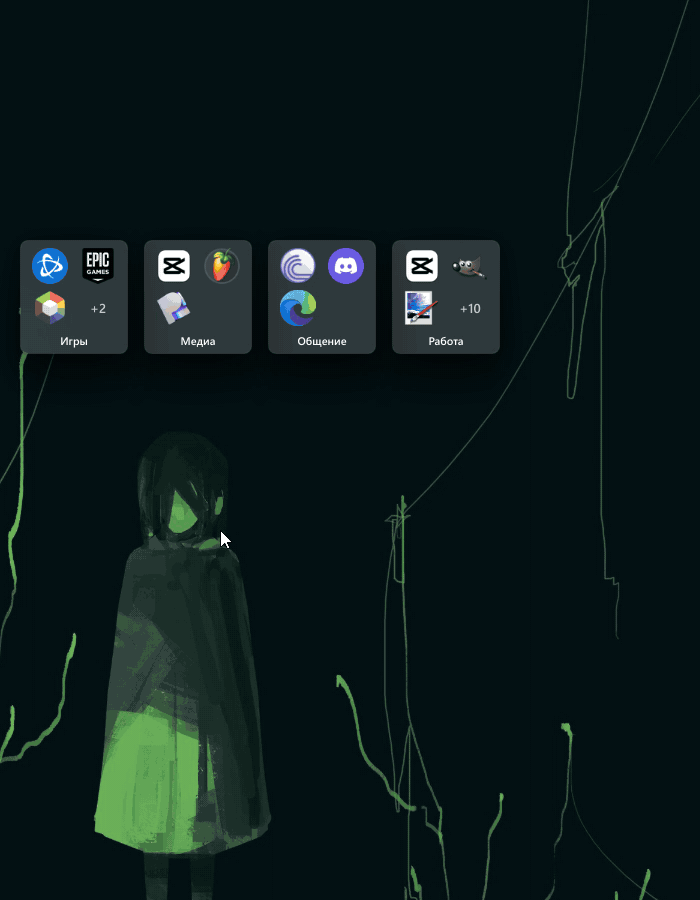
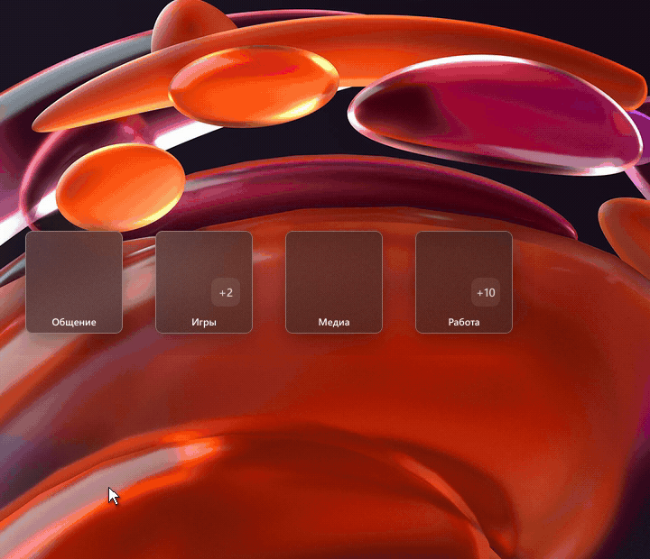
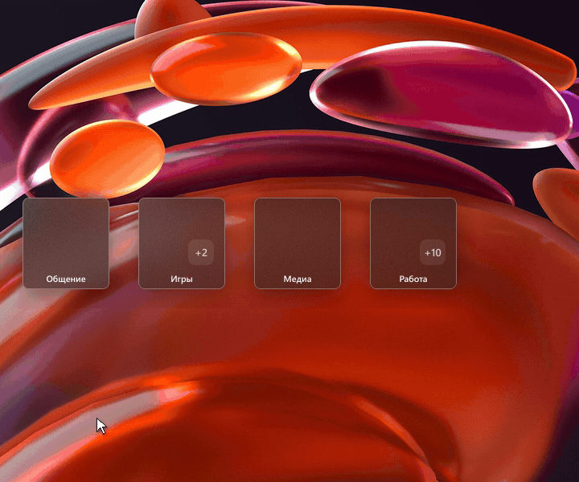

# Glass Folders

[English](README.md) · Русский

[](../../releases/latest) [](../../releases)

Папки как на телефоне, только для рабочего стола Windows.
Каждая папка на рабочем столе становится стеклянной плиткой с иконками приложений. Нажимаешь на неё, и открывается окно, где ярлыки разложены по группам.



## Зачем

По обычному значку папки не понять, что внутри, пока её не откроешь. На телефоне хватает четырёх маленьких иконок. Glass Folders делает так же на Windows.

## Возможности

**Плитки.** Каждая папка на рабочем столе становится плиткой с самыми используемыми приложениями. Плитку можно растянуть, чтобы видеть больше иконок, передвинуть куда угодно и выровнять по сетке. Приложение запускается кликом по иконке прямо на плитке.



**Группы.** Внутри папки ярлыки лежат в группах. Перетащи ярлык на пустое место, и появится новая группа: дай ей название и цвет. Группы можно двигать и растягивать, остальные сами подвинутся.



**Настройки.** Можно спрятать названия и подписи, чтобы остались только иконки, прижать группы к углу, выбрать плотность стекла и размер иконок.



**Закрепление.** Папку можно оставить открытой на рабочем столе, как виджет.



**Правая кнопка на ярлыке** (в папке или на плитке): переименовать, сменить значок, удалить ярлык или удалить всю программу. Для удаления программы запускается её собственный деинсталлятор, перед этим приложение спрашивает подтверждение.



**Перетаскивание туда и обратно.** Бросай файлы и ярлыки с рабочего стола или из Проводника прямо на плитку или в нужную группу (с Ctrl — копия). Вытащи ярлык на плитку другой папки, чтобы перенести его туда, или на свободное место стола, чтобы вернуть обратно.


**Живая синхронизация.** Создавай, переименовывай или удаляй папки и файлы на рабочем столе прямо во время работы — плитки и открытые окна обновляются сами.

**Трей, автозапуск и Win+D.** Автозапуск с Windows включается в настройках или через иконку в трее. Плитки и закреплённые папки не прячутся при нажатии **Win+D**.

**Быстро и плавно.** Папки открываются сразу, даже если в них сотни ярлыков. Анимации идут в такт частоте экрана.

## Файлы остаются твоими

Никакой базы данных нет. Плитка — это настоящая папка на рабочем столе, группа — настоящая подпапка внутри неё. Расположение и цвета хранятся в маленьком скрытом файле `.glassfolder.json` в каждой папке.
Закрыл приложение — и у тебя те же обычные папки, что и раньше. Даже если программа вылетела или её закрыли через Диспетчер задач: маленький процесс-помощник вернёт папки на место.

## Установка

1. Скачай `glass-folders.zip` из [Releases](../../releases/latest) и распакуй.
2. Запусти `glass-folders.exe`.
3. Чтобы выйти, нажми правой кнопкой по иконке в трее → **Выход**, или открой любую папку → шестерёнка → **Закрыть программу**.

Нужна Windows 11 с включёнными эффектами прозрачности (Параметры → Персонализация → Цвета).
Интерфейс на русском и английском (берётся из языка Windows, меняется в настройках). Exe не подписан, поэтому при первом запуске Windows SmartScreen может попросить подтверждение.

## Лёгкое

Написано на Rust со [Slint](https://slint.dev) и небольшим своим слоем для Win32.
Около 10 МБ на диске, 20–30 МБ памяти, в покое не нагружает процессор.

## Сборка

```
cd app
cargo build --release
```

Exe появится в `app/target/release/`.

## Лицензия

[MIT](LICENSE)
